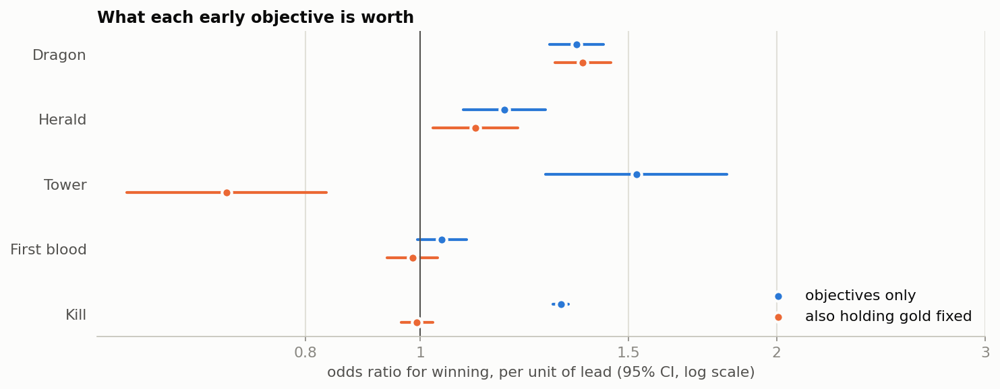

# League of Legends: what do the first 10 minutes tell us?

Across 9,879 high-rank games, overall side balance is fine: blue wins 49.90% (95% CI 48.92% to 50.89%). But the sides don't reach objectives equally: red leads on dragon in 53.3% of contested games, and blue leads on herald in 54.0%. **Dragon looks worth somewhat more than herald:** when one team takes each, the dragon team wins 53.3% (95% CI 50.6% to 55.9%). 10-minute state forecasts the winner well overall (AUC 0.81), but only 59.3% of the time in close games. This is observational data, so these are associations.



**Read next:** [decision memo](case_study.md) (one page, for a studio head) · [analysis code](src/analysis.py) · [every number](out/results.json)

Decision rules are fixed at the top of [the analysis script](src/analysis.py), and each script stops if its data checks fail. This is independent analysis of public data, and isn't affiliated with any company or game named here.

## How to reproduce

```bash
python3 -m venv .venv && source .venv/bin/activate
```

```bash
pip install -r requirements.txt
```

```bash
tools/get_data.sh
```

```bash
python src/analysis.py
```

## Repo structure

```text
.
├── case_study.md        one-page decision memo
├── src/analysis.py      data checks, analysis, charts
├── src/gamestats.py     statistics helpers and chart style
├── tools/get_data.sh    downloads the source data (not redistributed)
├── out/                 results.json, charts, tables
└── data/                where the download goes
```

## Skills

Logistic regression · cross-validation · game balance analysis · multiple-comparison correction · Python

## More case studies

- [Cookie Cats gate A/B test](https://github.com/rahulkundanjha-blip/cookie-cats-ab-test)
- [Steam player decay after launch](https://github.com/rahulkundanjha-blip/steam-player-decay)
- [Steam library activation](https://github.com/rahulkundanjha-blip/steam-library-activation)
- [Lichess matchmaking and first-move fairness](https://github.com/rahulkundanjha-blip/lichess-matchmaking)

## Contact

KinetiArc
