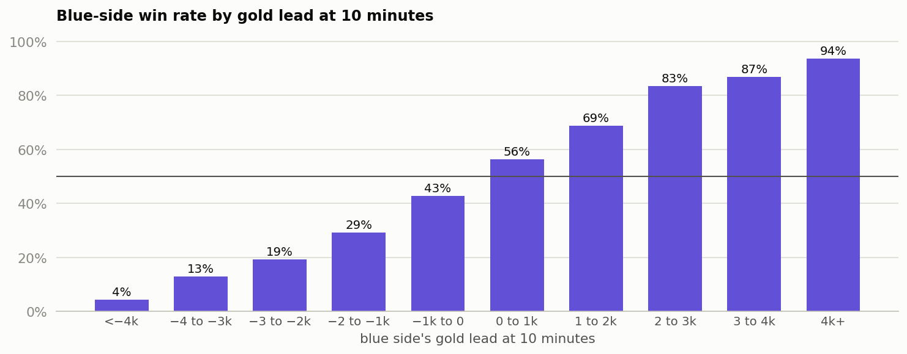
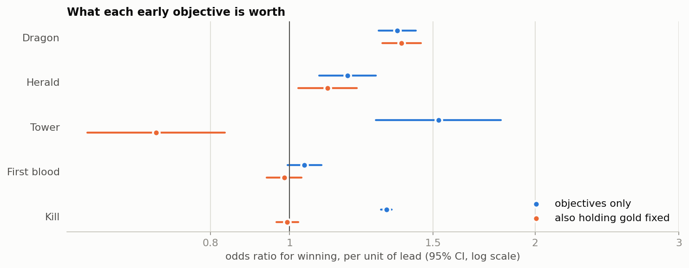

# League of Legends: what do the first 10 minutes tell us?

*Rahul Jha, KinetiArc. Independent analysis of public data; not affiliated with Riot Games.*

## 1. Decision

**Don't flag overall side balance, but do review why each side favours a different early objective, and favour dragon over herald only modestly, because the head-to-head edge is 53.3%.** These are associations from observational data, and stronger teams may simply take more dragons.

## 2. What we looked at

9,879 high-rank ranked games, with each side's stats at the 10-minute mark and who won.
No duplicate games or empty cells. The main rules were fixed before running.

## 3. What happened

- **Overall balance:** blue wins 49.90% (range 48.92% to 50.89%), and its average gold lead is 14 (not significant).
- **Objective access is uneven:** where one side leads, blue has the dragon lead in only 46.7% of games (3,576 vs 4,081) and the herald lead in 54.0% (1,857 vs 1,581). Both differences are significant, but they don't add up to a win-rate gap.
- **Dragon vs herald, head to head:** in 1,352 games where one team led on dragon and the other on herald, the dragon team won 53.3% (range 50.6% to 55.9%), despite being 166 gold behind on average.

| Lead at 10 minutes | Odds ratio for winning | 95% range | Holding gold fixed |
|---|---|---|---|
| Tower | 1.52 | 1.28 to 1.82 | 0.69 |
| Dragon | 1.36 | 1.29 to 1.43 | 1.37 |
| Kill | 1.31 | 1.30 to 1.33 | 0.99 |
| Herald | 1.18 | 1.09 to 1.28 | 1.11 |
| First blood | 1.04 | 0.99 to 1.09 | 0.99 |

| Win rate by gold lead | Objective odds ratios |
|---|---|
|  |  |

## 4. Can we trust it?

- **The forecast:** AUC is 0.81 with 5-fold cross-validation, above the 0.75 rule, and predictions stay within 2.5 points of actual win rates. It's strong when games are lopsided (79.8% correct) and weak when they're close (59.3%), and those close games are 32.9% of the total.
- **Holding gold fixed:** gold is partly how objectives pay off, so that column doesn't show their total value. Towers and kills fade because they mostly work through gold, and the 0.69 doesn't mean towers hurt. Dragon barely changes (1.37), so its value isn't only gold.
- **The size of the dragon edge:** raw win rates (64.1% with a dragon lead, 59.5% with a herald lead) overstate the gap. The head-to-head 53.3% is the fairer figure, and its range nearly reaches 50%.

## 5. What it means for the business

For a balance team, the side question isn't "who wins more" but "why do sides reach objectives differently, and does it matter?". At this rank it doesn't show up in wins. For a live win-probability feature, 10-minute state is reliable when a game is lopsided, and little better than a coin flip in the close games viewers care about most.

## 6. Next experiment

Repeat across ranks and patches. Hypothesis: uneven objective access becomes a win-rate gap at lower ranks, where teams adapt less. Metrics: side win rate and objective share by rank. Guardrail: sample size within each patch. This needs match data with patch numbers and champion picks.

## 7. Limitations

- One high-rank sample, with no patch or date, so it may not apply to other ranks or today's game.
- No champion picks or player skill data, either of which could explain both objectives and wins.
- The objective-access finding came from the second look, not the rules set in advance, so confirm it on new data.
- Only the 10-minute mark is included, so later comebacks and game length aren't visible.
- The file came from a GitHub copy of a public Kaggle dataset. Its shape and gold totals check out, but I didn't compare it against the original.
